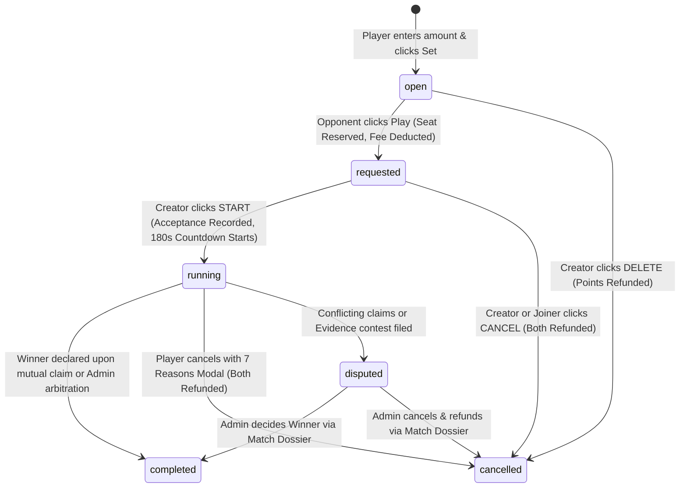

# FSALUDOCLUB — BATTLE LIFECYCLE COMPREHENSIVE ARCHITECTURAL AUDIT

**Document Date:** October 15, 2026  
**Auditor:** Senior Laravel Backend Architect, Real-Time Application Engineer & Database Designer  
**Platform:** Fsaludoclub / Malik Ludo Gaming Platform  
**Environment:** Laravel 10.46.0 | PHP 8.2+ | MySQL InnoDB | Apache/Nginx  

---

## 1. Executive Summary

This architectural audit evaluates the complete match and battle lifecycle across backend models, database constraints, controller workflows, view components, frontend synchronization, and administrative supervision.

The platform provides a peer-to-peer tournament battle lobby where registered players create challenges (with virtual points entry), opponents accept challenges, matches transition through explicit states (`open` &rarr; `requested` &rarr; `running` &rarr; `completed` / `cancelled` / `disputed`), participants exchange private Ludo King room codes under a live 180-second countdown, and results or issue reports are submitted.

---

## 2. Environment & Technical Stack

| Component | Specification |
|---|---|
| **Framework** | Laravel Framework 10.46.0 |
| **PHP Runtime** | PHP 8.2+ with PDO, GD, OpenSSL, Guzzle, BCMath |
| **Database** | MySQL (InnoDB engine, transactions, row-level locking support) |
| **Broadcasting Driver** | `null` (WebSockets/Pusher currently disabled in `.env`) |
| **Session & Cache** | File/Database driver with CSRF token protection |
| **Authentication** | Session-based stateful authentication + OTP phone verification |

---

## 3. Database Schema & Models Audit

### 3.1 `ludo_battles` Table Structure
```sql
CREATE TABLE `ludo_battles` (
  `id` bigint(20) unsigned NOT NULL AUTO_INCREMENT,
  `battle_uid` varchar(32) NOT NULL,
  `creator_id` bigint(20) unsigned NOT NULL,
  `joiner_id` bigint(20) unsigned DEFAULT NULL,
  `entry_fee` int(10) unsigned NOT NULL DEFAULT 50,
  `prize` int(10) unsigned NOT NULL DEFAULT 95,
  `status` varchar(32) NOT NULL DEFAULT 'open',
  `room_code` varchar(30) DEFAULT NULL,
  `room_code_expires_at` timestamp NULL DEFAULT NULL,
  `winner_id` bigint(20) unsigned DEFAULT NULL,
  `claimed_result` enum('pending','won','lost','cancelled') NOT NULL DEFAULT 'pending',
  `final_result` enum('pending','won','lost','cancelled','draw') NOT NULL DEFAULT 'pending',
  `cancellation_reason` varchar(150) DEFAULT NULL,
  `cancelled_by_id` bigint(20) unsigned DEFAULT NULL,
  `review_status` enum('auto_approved','under_review','verified','disputed') NOT NULL DEFAULT 'auto_approved',
  `creator_claimed_result` varchar(32) DEFAULT 'pending',
  `joiner_claimed_result` varchar(32) DEFAULT 'pending',
  `submission_deadline_at` timestamp NULL DEFAULT NULL,
  `started_at` timestamp NULL DEFAULT NULL,
  `completed_at` timestamp NULL DEFAULT NULL,
  `dispute_id` bigint(20) unsigned DEFAULT NULL,
  `created_at` timestamp NULL DEFAULT NULL,
  `updated_at` timestamp NULL DEFAULT NULL,
  PRIMARY KEY (`id`),
  UNIQUE KEY `ludo_battles_battle_uid_unique` (`battle_uid`),
  KEY `ludo_battles_status_index` (`status`)
) ENGINE=InnoDB DEFAULT CHARSET=utf8mb4 COLLATE=utf8mb4_unicode_ci;
```

### 3.2 Related Database Tables Reused
1. `ludo_ledger_transactions`: Immutable double-entry ledger ensuring points deductions and refunds are strictly balanced and never lost.
2. `ludo_disputes`: Complainant vs. respondent claims with category, description, and status (`open`, `resolved`, `rejected`).
3. `ludo_dispute_evidence`: Secure storage paths for user-submitted winning/match issue screenshots.
4. `ludo_admin_audit_logs`: Audit trail for all administrative overrides, cancellations, and settlements.
5. `ludo_upi_deposits`: Direct UPI QR deposit tracking without 3rd-party merchant gateways.

---

## 4. Lifecycle State Machine



### State Machine Transition Rules
| Source State | Trigger | Target State | Authorized Actor | Coin Side-Effects |
|---|---|---|---|---|
| *None* | `POST /battles/create` | `open` | Authenticated Player | Creator entry fee deducted to ledger |
| `open` | `POST /battles/{id}/cancel` | `cancelled` | Creator only | Creator entry fee refunded |
| `open` | `POST /battles/{id}/join` | `requested` | Opponent (Non-creator) | Opponent entry fee deducted to ledger |
| `requested` | `POST /battles/{id}/start` | `running` | Creator only | None (Match locked, 180s room timer starts) |
| `requested` | `POST /battles/{id}/cancel` | `cancelled` | Creator or Joiner | Both Creator & Joiner fees refunded |
| `running` | `POST /battles/{id}/room-code` | `running` | Creator or Joiner | Room code saved (Immutable) |
| `running` | `POST /battles/{id}/cancel-with-reason` | `cancelled` | Creator or Joiner | Both refunded if no result finalized |
| `running` | `POST /battles/{id}/result` | `completed` / `disputed` | Participants | Winner credited prize or Dispute opened |

---

## 5. Audit Findings & Identified Gaps

### Gap 1: Race Condition on Simultaneous Join Attempts
- **Defect:** `joinBattle()` previously loaded `$battle = LudoBattle::findOrFail($id)` without a database lock (`lockForUpdate()`).
- **Risk:** If two opponents clicked "Play" at the exact same millisecond, both read `status == 'open'`, both had points deducted from their balance, and the second write overwrote `joiner_id`. The first player lost points without a match.
- **Resolution:** Wrap `joinBattle()` in `DB::transaction()` with `LudoBattle::lockForUpdate()->find($id)`. If the row is not in `open` state, rollback immediately and return an error message.

### Gap 2: Create Battle Full-Page Reload vs. Seamless UI
- **Defect:** Creating a battle previously triggered a standard full-page HTTP POST redirect, breaking visual flow and causing flicker.
- **Resolution:** Enhance `createBattle()` to return JSON with the pre-rendered card HTML and updated balance when called via AJAX/Fetch, while preserving standard POST fallback for non-JS browsers. Client-side button debouncing prevents duplicate retries.

### Gap 3: Real-Time Synchronization in Absence of WebSockets
- **Defect:** `BROADCAST_DRIVER` is `null`. Without WebSockets, users on the Play page had to refresh manually to notice that an opponent joined or that a battle was started.
- **Resolution:** Implement a dedicated, lightweight synchronization polling endpoint (`/battles/sync-state`) combined with smart frontend polling:
  1. Polls every 3.5 seconds only when document is visible (`!document.hidden`).
  2. Stops automatically when tab is inactive.
  3. If user's created battle is joined (`status == 'requested'`), updates card to show START & CANCEL buttons.
  4. If user is the joiner and creator clicks START, automatically redirects to Match Arena (`/battles/{id}`).
  5. Syncs room code and match cancellation in Match Arena.

### Gap 4: Room Code Immutable Protection
- **Defect:** Once a room code was submitted, any participant could repeatedly submit new codes, overwriting the room without history.
- **Resolution:** Enforce that room codes can only be set once when `room_code` is null and match is `running`. Once set, the code is immutable on player-side and displayed with copy button and Ludo King launcher.

### Gap 5: Cancellation Reason Modal & Reporting Integrity
- **Defect:** Matches cancelled during room code phase needed an explicit 7-reason categorization matching reference Screenshot #5 ("No Room code", "Not joined", "Not Playing", "Dont Want to Play", "Opponent Abusing", "Game not Started", "Others") with instant ledger refunds.
- **Resolution:** Ensure `cancelWithReason()` executes under pessimistic locking, validates against allowed reasons, updates `cancelled_by_id`, `cancellation_reason`, and refunds points atomically.

---

## 6. Implementation Plan

1. **Backend Concurrency Hardening:**
   - Add `lockForUpdate()` across `joinBattle()`, `startBattle()`, `cancelBattle()`, `cancelWithReason()`, and `setRoomCode()`.
   - Implement `/battles/sync-state` API for active match detection and live updates.
2. **Frontend AJAX & Polling Integration:**
   - Enhance `createBattle` frontend handler to post via Fetch, prepend new battle card without reload, and update points badge.
   - Attach smart polling loop to `#open-battles-section` and `.ludo-arena-card`.
3. **Room Code Access Control & Audit:**
   - Guard `setRoomCode` against duplicate overwrites and check expiry.
4. **Verification & Testing:**
   - Execute 15 automated test cases simulating concurrent joins, two-player match progression, cancellations, room code submissions, and admin oversight.
